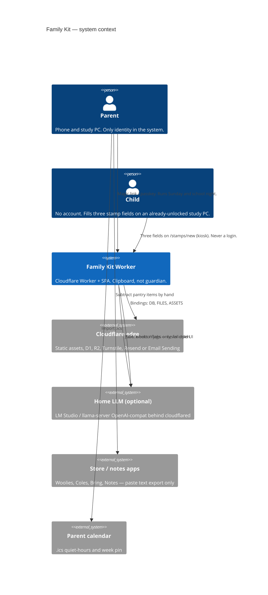
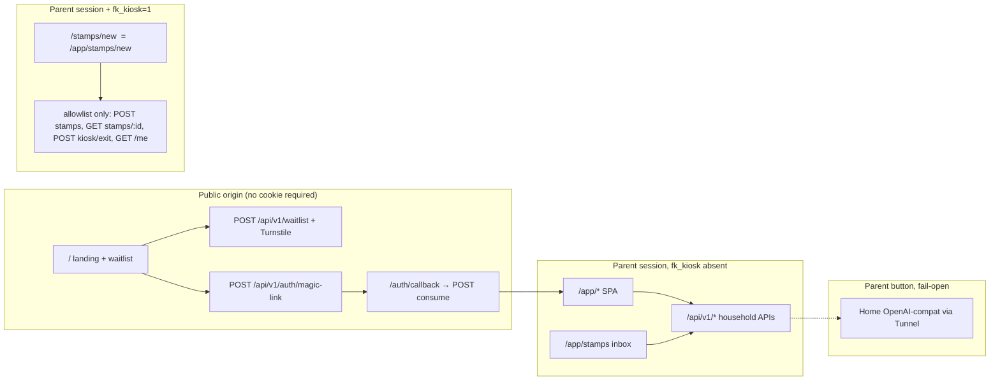
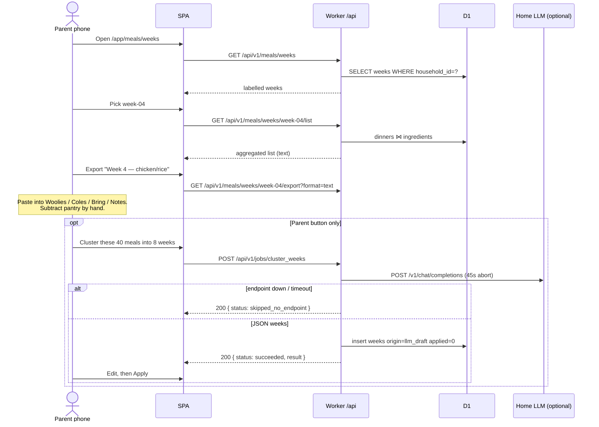
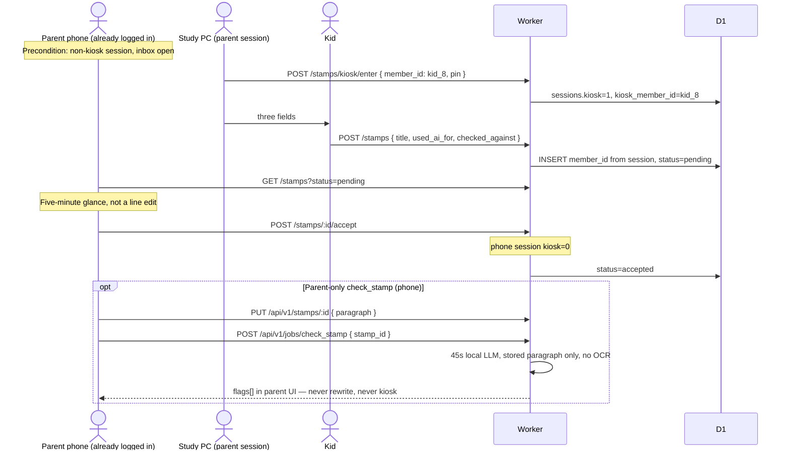

# Family Kit — System Architecture

| Field | Value |
| --- | --- |
| **Title** | Family Kit system architecture |
| **Author** | TBD |
| **Date** | 2026-08-28 |
| **Status** | Draft (rev 4) — user decisions incorporated 2026-08-28 |
| **Product of record** | Family Kit on the live origin. Repo stays `swiftsellai-ssa/familysai`. |
| **Deploy** | Workers Builds / `wrangler deploy` (not Pages). A Cloudflare-DNS domain exists; hostname string is ops fill-in. |
| **Canonical statement** | Not a guardian. Software is the clipboard. The adult stays in the room. |
| **Runtime** | Cloudflare Workers + Static Assets |
| **Account plan** | Workers Paid required for v1 (see KD-16) |
| **Source of truth for this doc** | Product sketch (this file's predecessor) + live repo `swiftsellai-ssa/familysai@0beea9c` |

---

## Overview

Family Kit is household software for two jobs parents already described: **meal weeks** (a canon of loved dinners, labelled 5-night weeks, a shopping list you subtract from) and a **homework gate** (a printable house-rules card, a bones-first stamp, a parent glance before anything is submitted). A thin **household** layer holds people, labelled places (homework table, phone shelf), and quiet-hours reminders. Rooms and devices are strings on that record, not a social graph. It is not a co-parent, not a tutor, and not a child-safety product.

The live site today is a Vite + React waitlist SPA branded **FamilyAI** ("Meet your new AI co-parent"), pushed through Cloudflare, with no Worker, no D1, no auth, and a hardcoded Web3Forms access key. This document specifies how that same git-connected Cloudflare surface becomes the Family Kit app: one Worker serving public landing assets plus a parent-authenticated SPA under `/app`, D1 for household records **and** sessions/tokens/rate limits, R2 for the YAML/markdown "files on disk" shape, and an optional **parent-only** OpenAI-compat batch worker on a home box (LM Studio / llama-server) reached through Cloudflare Tunnel. If that endpoint is down, Sunday meals and school-night stamps still work.

**Success test (load-bearing):** a parent can run a Sunday and a school night with the model unplugged. First merge that must pass: **Sunday list + school-night stamp with LLM unconfigured.** If the product needs the child to be alone with a bot to work, the architecture failed.

---

## Background & Motivation

### Product canon (preserved)

Parents described two modules plus a shared household layer. That split is the product, not a marketing theme:

- **Meal weeks** — canon of loved dinners → labeled 5-night weeks → shopping list you subtract from.
- **Homework gate** — house rules card, bones-first stamp, parent glance before submit.
- **Household** — people, labelled places (homework / meals / charge / phones), quiet hours (reminders only).

Software is the clipboard. The adult stays in the room.

### Current website (what actually exists)

Local workspace `C:\projapp\family'sai\` currently contains only this architecture file. The live/source website is:

| Fact | Value | Confidence |
| --- | --- | --- |
| GitHub | [`https://github.com/swiftsellai-ssa/familysai`](https://github.com/swiftsellai-ssa/familysai) (public, JavaScript) | Known |
| Default branch / SHA | `main` / `0beea9c334dbf51e2f0c549bce57637c742b5e39` | Known |
| Local twin | `C:\projapp\growth-rings\family-ai-landing\` | Known |
| `package.json` `name` | `family-ai-landing` | Known |
| Stack | Vite 7.2.4 + React 19.2 + Tailwind 3.4 + lucide-react + `@microsoft/clarity` | Known |
| Components | `src/App.jsx`, `Header.jsx`, `Hero.jsx`, `MentalLoad.jsx`, `FeatureCards.jsx`, `WaitlistForm.jsx`, `Footer.jsx` | Known |
| Branding | **FamilyAI**. Hero: "Meet your new AI co-parent." Badge: "Trusted by 2,000+ early access parents." Footer: "FamilyAI Inc." FeatureCards: Smart Scheduling, Proactive Suggestions, Fair Share labor tracking | Known |
| Waitlist | `POST https://api.web3forms.com/submit` with access key `ff55b387-3925-4b8e-9709-732d79b594fa` in `WaitlistForm.jsx` (commented `// Placeholder`) | Known |
| Analytics | Microsoft Clarity project `vex619g7b3`, inited in production from `src/main.jsx` | Known |
| Cloudflare config in repo | **None.** No `wrangler.jsonc`, no Worker, no D1, no R2, no auth, no app routes | Known |
| Deploy | **Workers Builds / `wrangler deploy` — not Pages.** A custom domain exists on Cloudflare DNS. | Known (user, 2026-08-28). **Unknown:** Worker project name, account ID, exact hostname string |
| Dashboard API this session | Not authenticated. Do not invent a `workers.dev` hostname, account ID, or Worker project name | Known gap |

Verified by GitHub tree at SHA `0beea9c`: **27 git tree entries (23 blobs, 4 directories)**; `src/components/*` only; no `worker/`, no `wrangler.jsonc`.

### Pain points

1. **The waitlist pitch contradicts the product.** Landing copy promises an AI co-parent, generated meal plans, gamified chores, auto-scheduled appointments, calendar-conflict scheduling, "Fair Share" labor tracking, and "2,000+ early access parents." Family Kit forbids generated 7-night plans, child-facing models, guardian claims, and chore gamification. If the waitlist drives the data model, the architecture has already failed.
2. **No runtime for household data.** A static SPA cannot store stamps, weeks, or parent sessions. The sketch assumed Next.js + SQLite/markdown-on-disk; the deploy target is Cloudflare, which wants Workers Static Assets + D1 + R2.
3. **A production secret is in git.** The Web3Forms access key is in `WaitlistForm.jsx`. Treat it as leaked. Rotate it. Stop calling Web3Forms from the browser.
4. **Session replay on a family product.** Clarity records sessions on the waitlist form. That is the wrong default for a product that will later hold child homework text and textbook photos. **Clarity.init only when `location.pathname === '/'`** (PR-1, before any `/app` route exists).
5. **The homelab file model is the UX, not a storage engine.** Parents think in `household.yaml`, `meals/canon/*.yaml`, `stamps/*.yaml`. Cloudflare D1 is the query engine. Those files must remain importable and exportable.

### Why Cloudflare, and why now

The site is already pushed through Cloudflare **Workers Builds / `wrangler deploy`** (not Pages — decided 2026-08-28). Cloudflare's current guidance for new work is Workers Static Assets ([Workers best practices](https://developers.cloudflare.com/workers/best-practices/workers-best-practices/), [Static Assets](https://developers.cloudflare.com/workers/static-assets/)). The supported SPA pattern is Vite + React + `@cloudflare/vite-plugin` with a Worker API at `/api/*` ([React + Vite guide](https://developers.cloudflare.com/workers/framework-guides/web-apps/react/)).

This is not a greenfield marketing-site redesign. It is the system that lets a parent run the two modules on the platform they already ship to.

A custom domain already exists on **Cloudflare DNS**, so Workers custom domains and (later) Email Sending are possible. **Do not invent the hostname.** Attach that existing domain to the Worker at first deploy (ops fill-in). Skip any Pages→Workers migration.

---

## Goals & Non-Goals

### Goals (v1)

1. One Cloudflare Worker serves the public landing (`/`) and the parent app (`/app/*`).
2. Parent-only auth (magic link in v1, passkey as the next increment on the same session cookie). Child never has an identity.
3. One household. D1 holds relational records, sessions, magic-link tokens, and rate-limit counters. R2 holds YAML/markdown snapshots, hallucination screenshots, textbook photos.
4. Sunday flow: pick a labelled week → aggregate ingredients → named **plain-text** list export. Store apps (Woolworths / Coles / Bring / Notes) get the same text with a store-specific title until a real URL scheme exists.
5. School-night flow: **phone already logged in** → parent starts a stamp (selects which child) → kid fills **three fields** on the already-unlocked study PC → parent Accept / changes requested **on the phone**.
6. Printable house-rules card with the default Australian-context rules from the sketch.
7. Optional parent-only local LLM jobs: `cluster_weeks`, `scale_qty`, `check_stamp`. Run **synchronously** in the POST. Fail-open. Never address the child. Never auto-apply. No OCR in v1.
8. Waitlist stays, but submissions land in D1, behind Turnstile, with the leaked Web3Forms key removed.
9. A parent can **export** a zip that looks like the homelab folder (`household.yaml`, `meals/`, `rules/`, `stamps/`). Import is PR-12, not v1 dogfood.

### Non-goals (load-bearing — copy these)

- No chat interceptor on WhatsApp, Character.AI, school Canva, or Google.
- No always-on child monitoring, location, or keylogging.
- No teacher dashboard.
- No “keeps your child safe” claim.
- No model talking to the child when a parent is absent.
- No 7-night generated meal plans from a blank prompt.

### Also not v1

- Grocy pantry subtract.
- CalDAV / shared family calendar.
- Multi-household tenancy UI, invites, or billing.
- Kid accounts, kid feeds, kid notifications, kid LLM.
- Durable Objects, Queues, Workflows, Vectorize, Workers AI as a default model.
- KV as the session/token/rate-limit store.
- Local-first CRDT / `sqlite.wasm` / OPFS sync.
- Airplane-mode operation of the hosted app.
- Web Push (v1 is in-app + `.ics`; a Worker *can* send VAPID Web Push, but there is no Cloudflare-hosted push gateway — still not v1).
- Stamp or list **PDF generation in the Worker**. v1 is markdown + `window.print()`.
- `POST /api/v1/import` (zip bombs). PR-12.
- Textbook OCR. `check_stamp` uses optional parent-pasted `paragraph` only.
- Replacing the landing with a different brand **in the same PR as the data model** — copy realignment is a dedicated PR after the kit works.

---

## Key Decisions

| # | Decision | Rationale |
| --- | --- | --- |
| KD-1 | **Family Kit is the product of record and the live origin name.** Repo stays `swiftsellai-ssa/familysai`. The FamilyAI waitlist copy currently contradicts the kit; data model, routes, LLM jobs, and claims follow this document, not `Hero.jsx`. Landing copy is realigned in PR-11. | User decision 2026-08-28. If "AI co-parent / generated meal plans / gamified chores" drives schema, we will ship a guardian. |
| KD-2 | **Evolve `swiftsellai-ssa/familysai` in place** as one Worker + SPA. Do not split a monorepo in v1. Landing `/` and kit `/app/*` share the origin. Cookie `Path=/` with landing CSP + Clarity banned from authed routes (KD-18). | The repo is 23 blobs, already git-connected to Cloudflare, and v1 is one-household dogfood. Two apps doubles deploy/auth/CORS. Split to `app.` host later if landing XSS is unacceptable. |
| KD-3 | **Workers Static Assets on the existing Workers Builds project.** Vite + React SPA + `@cloudflare/vite-plugin` + Worker at `/api/*`. **Not Pages. No Pages→Workers migration.** A Cloudflare-DNS custom domain exists; attach it to this Worker at first deploy. Do not invent the project name, account ID, or hostname. | User decision 2026-08-28. Cloudflare recommends Workers Static Assets for new work; this project is already there. |
| KD-4 | **D1 is authoritative for queries; R2 preserves the file mental model.** Successful writes upsert YAML/markdown under a household prefix (best-effort). Export zip always regenerates from D1. | "Weeks and stamps are files" is a UX/backup contract. D1 is the query engine. |
| KD-5 | **Parent account only.** Magic link for v1; passkeys in PR-12 once the CF-DNS hostname is written into wrangler (ops fill-in, not a product fork). Child never has an identity. | Matches the trust boundary. User has a CF-managed zone; `rpId` is that hostname when recorded. |
| KD-6 | **Kiosk is deny-by-default Worker middleware on the parent session, not a kid login.** Allowlist is the table in §4. **PIN is required to enter and to exit.** If `kiosk_pin_hash` is null, enter returns `kiosk_pin_required`. Empty PIN on exit is `kiosk_denied`. Kiosk `GET /me` returns **only** `{ kiosk: true, kiosk_member_id, member_label }` — never pin, salt, llm_*, or email. Accept happens on the **phone**, already logged in **before** kiosk enter. Parent selects `member_id` on enter, not on kid submit. Set-PIN ships in **PR-8** so the school-night merge is production-usable. | T1. Optional PIN with default-off is "kid clicks Exit." Full household dump on `/me` would leak PIN salt to the study PC. |
| KD-7 | **Optional LLM is a parent-only batch worker on a home box.** OpenAI-compat via Cloudflare Tunnel. Workers AI is not the default. Hosted OpenAI/Anthropic are not on the critical path. | Canon. Fail-open is the success test. |
| KD-8 | **v1 "unplugged" means the model is unplugged, not airplane mode.** | Dogfood is one household with a phone and a study PC. |
| KD-9 | **Quiet hours v1 = in-app banner + downloadable `.ics`.** No MDM. No child app. No Web Push in v1. | Web Push is buildable with VAPID on Workers; Cloudflare still has no hosted push gateway. `.ics` is already an export. |
| KD-10 | **One D1 database. Household-owned rows use composite PK `(household_id, id)`.** YAML slugs (`butter-chicken`, `parent_a`, `kid_8`) are the `id` *within* a household, never a global PK. FKs include `household_id`. No Durable Objects. | Two waitlist families must both be allowed a meal named `butter-chicken`. |
| KD-11 | **Waitlist moves into the Worker immediately** (`migrations/0001_waitlist.sql` + Turnstile). Web3Forms key is leaked. | Browser-held access keys are write-anyone-with-the-JS. |
| KD-12 | **Australia is not a D1/R2 jurisdiction.** Create D1 and R2 with location hint `oc`. User accepted that as enough (2026-08-28). Privacy copy stays honest: **not AU residency.** Homework blobs live where D1/R2 put them. | Jurisdictions: D1 `eu`\|`fedramp`; R2 `eu`\|`fedramp`\|`us`. Hints are best-effort. |
| KD-13 | **TypeScript on the Worker from day one.** SPA may stay `.jsx` then migrate. `npx wrangler types` owns `Env`. Never hand-write binding interfaces. | Cloudflare's documented path. |
| KD-14 | **Default grocery context is Woolworths, then Coles.** v1 export is `text` (and week `.ics`). `woolworths`\|`coles`\|`bring`\|`notes` are the same text with a different first line until a real URL scheme exists. | Australian household. Do not fake a Woolies deep link. |
| KD-15 | **Dogfood mailer is Resend** (`RESEND_API_KEY` secret). `vars.MAILER=log` is allowed **only** when `SIGNUPS_OPEN=dogfood` (magic URL in Workers Logs, never in production waitlist). Cloudflare Email Sending is the later path once the zone is on Cloudflare DNS + Workers Paid. | PR-7 (magic link) cannot merge on "pick at implement time." Email Sending is Paid + CF DNS + public beta. |
| KD-16 | **Workers Paid is required for v1.** Free is 10 ms CPU and no Email Sending. | LLM jobs wait on `fetch` (not CPU), but Paid is the plan we size against (30 s CPU default, 5 min max). Do not ship production on Free. |
| KD-17 | **Sessions, magic-link tokens, passkey challenges, and rate-limit counters live in D1.** Not KV. Cookie `Max-Age` is set at login; **do not write `last_seen_at` on every `/api` call.** | KV is eventually consistent (~60 s) and **1 write/sec to the same key**. Single-use consume and sliding session writes are not KV-safe. |
| KD-18 | **Session cookie `Path=/`.** Landing and kit share the origin. Landing CSP is strict; Clarity `init` only when `pathname === '/'` (**PR-1**, not delayed to stamps). XSS on the FamilyAI landing can still steal `fk_session` until copy/Clarity are cleaned — treat PR-11 as security, not marketing. Split `app.` host is v1.1 if needed. | One origin is the v1 deploy. Cookie Path=/app would break `/stamps/new` and `/auth/callback` aliases. |
| KD-19 | **Hono is the Worker router.** | Fits Cloudflare D1 tutorials, typed `Bindings: Env`, `export default app` is a valid fetch handler. Not itty-router, not raw `fetch` trees. |
| KD-20 | **LLM jobs run synchronously in the POST.** Status is `running` → `succeeded` \| `failed` \| `skipped_no_endpoint`. No `queued`, no Queues, no poll-to-complete. `GET /jobs/:id` is for refresh after the POST returns. `check_stamp` is parent-pasted `paragraph` only; **no OCR in v1.** Cap `request_json` at 32 KB, model output at 32 KB, `paragraph` at 32 KB. Abort at 45 s. | Queues/DOs/Workflows are non-goals. Polling a job that never leaves the request is fiction. |
| KD-21 | **LLM bearer is per-household ciphertext.** Column `households.llm_key_wrapped`. Worker secret `LLM_KEY_WRAP` (AES-GCM key) wraps it. Empty column = no key sent. SPA never sees plaintext. | One sentence, one column, one secret. Not a global `HOME_LLM_KEY`. |
| KD-22 | **URL map (only one).** Landing `/`. Kit under `/app/*` with **no** React Router `basename` (routes declared as `/app/...`). Origin-root **aliases**: `/stamps/new` → same kiosk page as `/app/stamps/new`; `/auth/callback` → consume page. Magic-link 302 after consume: `/app/onboarding` or `/app/meals/weeks`. | School-night URL is `/stamps/new`. Printable card is `/app/rules`. |

---

## Proposed Design

### 1. System context



Trust boundary (from the sketch, still exact):

```
Parent device(s)     Child does not need an account
       │
       ▼
Family Kit (web app + optional local LLM)
  - household.yaml
  - meals/
  - rules/
  - inbox/   (stamps waiting for parent glance)
       │
       ▼
Exports only
  - shopping list (plain text; Woolies / Coles / Bring / Notes by title)
  - .ics week pin and quiet hours
  - printable rules card (window.print)
  - stamp markdown attached to the school file
```

Child workflow: parent starts a stamp (child already chosen), kid fills three fields on the family study computer, parent taps Accept **on the phone**. No kid login, no kid feed, no notifications to the child.



### 2. Repo / deploy topology

**Pick: one repo, one Worker, two URL spaces (`/` and `/app`).**

```
swiftsellai-ssa/familysai
├── src/
│   ├── landing/                 # current Header/Hero/FeatureCards/...
│   ├── app/                     # kit pages; React Router paths /app/...
│   │   ├── onboarding/
│   │   ├── meals/
│   │   ├── rules/
│   │   ├── stamps/              # inbox + new (also mounted at /stamps/new)
│   │   └── settings/
│   ├── auth/                    # /auth/callback consume page
│   └── main.jsx
├── worker/
│   ├── index.ts                 # Hono; kiosk allowlist lives here
│   ├── middleware.ts            # requireParent, requireKioskAllowlist
│   └── ...
├── migrations/
│   ├── 0001_waitlist.sql
│   └── 0002_household.sql
├── seeds/
│   ├── house.md
│   └── dogfood/                 # fixture household YAML for the success test
├── wrangler.jsonc
├── vite.config.ts
├── package.json
└── worker-configuration.d.ts    # wrangler types, committed
```

**CI.** [Workers Builds](https://developers.cloudflare.com/workers/ci-cd/builds/) from GitHub: Worker dashboard name **exactly matches** `name` in `wrangler.jsonc` (`family-kit`). Production branch `main` runs `npm run deploy` (`vite build && wrangler deploy`). Preview commits run `wrangler versions upload`.

#### First-deploy checklist (ops fill-in — do not invent)

**Already decided (2026-08-28):** Workers Builds / `wrangler deploy` (not Pages — skip migration). A custom domain exists on Cloudflare DNS — attach it to this Worker. D1/R2 location hint `oc`. Product name on origin: Family Kit. Repo: `swiftsellai-ssa/familysai`.

Fill these in the dashboard / wrangler **at deploy time**. This session does not invent them.

| # | Fill-in | Notes |
| --- | --- | --- |
| 1 | Worker project `name` in dashboard vs `wrangler.jsonc` (`family-kit`) | Must match or the build fails. Do not invent the existing dashboard name if it differs — align them. |
| 2 | Exact custom-domain hostname | CF-managed zone exists. Write it into the Worker custom domain + magic-link + passkey `rpId`. **Ops leftover, not a product fork.** |
| 3 | Cloudflare account ID | Bind D1/R2. Never commit as a secret-of-the-product. |
| 4 | Account plan **Workers Paid**? | Required (KD-16). Confirm before production. |
| 5 | `vars.DOFOOD_EMAIL` | Operator's GitHub/Cloudflare login email (GitHub user `swiftsellai-ssa`, name Gab). **Do not invent the mailbox** — paste the address that account actually uses at `wrangler deploy` time. |

**Still do not invent:** account ID, Worker project name, hostname string, email address.

### 3. Runtime

Worker `fetch` is TypeScript + **Hono** (KD-19). Routing: static assets first; Worker first for `/api/*` ([SPA advanced routing](https://developers.cloudflare.com/workers/static-assets/routing/single-page-application/), Wrangler ≥ 4.20.0, Vite plugin ≥ 1.7.0). `/auth/callback` and `/stamps/new` are SPA paths (not Worker-first); `not_found_handling = "single-page-application"` serves `index.html`.

```jsonc
{
  "$schema": "./node_modules/wrangler/config-schema.json",
  "name": "family-kit",
  "compatibility_date": "2026-08-28",
  "compatibility_flags": ["nodejs_compat"],
  "main": "./worker/index.ts",
  "assets": {
    "not_found_handling": "single-page-application",
    "binding": "ASSETS",
    "run_worker_first": ["/api/*"]
  },
  "observability": {
    "enabled": true,
    "logs": { "invocation_logs": true, "head_sampling_rate": 1 }
  },
  "vars": {
    "SIGNUPS_OPEN": "dogfood",
    "MAILER": "resend",
    "DOFOOD_EMAIL": "<SET_AT_DEPLOY — operator GitHub/Cloudflare login email; do not invent>"
  },
  "secrets": {
    "required": [
      "SESSION_SECRET",
      "MAGIC_LINK_SIGNING_KEY",
      "TURNSTILE_SECRET_KEY",
      "RESEND_API_KEY",
      "LLM_KEY_WRAP"
    ]
  },
  "d1_databases": [
    {
      "binding": "DB",
      "database_name": "family-kit",
      "database_id": "<SET_AT_CREATE_TIME>",
      "migrations_dir": "migrations"
    }
  ],
  "r2_buckets": [
    {
      "binding": "FILES",
      "bucket_name": "family-kit"
    }
  ]
}
```

Notes:

- Do **not** set `assets.directory` when using the Vite plugin ([Static Assets](https://developers.cloudflare.com/workers/static-assets/)).
- `database_id` is created by `wrangler d1 create family-kit --location=oc`, not invented here. **No KV namespace in v1.**
- `npx wrangler types` after every binding change. Never hand-write `interface Env`.
- Secrets via `npx wrangler secret put`. Local: `.dev.vars` (gitignored).
- Enable `nodejs_compat` so `@simplewebauthn/server` and any Node YAML deps work; confirm at first `wrangler dev`. The `yaml` package is largely isomorphic — compat is belt-and-suspenders, not a claim that YAML is Node-only.
- `MAILER=log` is rejected at boot unless `SIGNUPS_OPEN=dogfood`.
- `SIGNUPS_OPEN=dogfood` issues magic links **only** for `vars.DOFOOD_EMAIL` (case-fold). Other emails get the same `{ ok: true }` with no token. `waitlist` mode never auto-creates a household.
- Optional later: `"send_email": [{ "name": "EMAIL" }]` when Email Sending replaces Resend.

#### URL map (KD-22) — the only map

React Router: **no `basename`**. Declare paths as written. Cloudflare SPA fallback serves `index.html` for every path below except `/api/*`.

| Public path | What it is |
| --- | --- |
| `/` | Family Kit landing + waitlist (copy still says FamilyAI until PR-11) |
| `/auth/callback` | SPA page: read `?token=`, `POST /api/v1/auth/magic-link/consume`, `history.replaceState` to strip the token, then client-navigate |
| `/stamps/new` | **Alias** of `/app/stamps/new` (kiosk). School-night URL the study PC types |
| `/app/onboarding` | Household size, store, homework place, home-AI stance |
| `/app/meals/canon` | Loved dinners |
| `/app/meals/weeks` | Labelled weeks |
| `/app/meals/weeks/:id` | Dinners + text export |
| `/app/rules` | Editable card + print |
| `/app/rules/examples` | Hallucination folder |
| `/app/stamps` | Parent inbox (phone) |
| `/app/stamps/new` | Three fields (kiosk) |
| `/app/settings` | Quiet hours, export target, LLM endpoint, **kiosk PIN** |

Magic-link consume 302/client-nav: `/app/onboarding` if `household.onboarded=0`, else `/app/meals/weeks`.

#### Worker router (normative, not illustrative)

Kiosk enforcement is **deny-by-default middleware**, not a comment inside `createStamps`. Copying this sketch without the allowlist is a failed review.

```ts
// worker/middleware.ts
const KIOSK_ALLOW: ReadonlyArray<{ method: string; pattern: RegExp }> = [
  { method: "GET",  pattern: /^\/api\/v1\/me$/ },
  { method: "POST", pattern: /^\/api\/v1\/stamps$/ },
  { method: "GET",  pattern: /^\/api\/v1\/stamps\/[^/]+$/ }, // :id only; handler scopes to kiosk_stamp_id
  { method: "POST", pattern: /^\/api\/v1\/stamps\/kiosk\/exit$/ },
];

export async function requireParent(c: Context, next: Next) {
  const session = await loadSession(c); // D1 sessions by cookie id + HMAC
  if (!session) return c.json({ error: "unauthenticated" }, 401);
  c.set("session", session);
  return next();
}

export async function requireKioskAllowlist(c: Context, next: Next) {
  const session = c.get("session");
  if (!session.kiosk) return next();
  const path = new URL(c.req.url).pathname;
  const ok = KIOSK_ALLOW.some((r) => r.method === c.req.method && r.pattern.test(path));
  if (!ok) return c.json({ error: "kiosk_denied" }, 403);
  return next();
}
```

```ts
// worker/index.ts
import { Hono } from "hono";
import { requireParent, requireKioskAllowlist } from "./middleware";

const app = new Hono<{ Bindings: Env }>();

app.route("/api/v1/waitlist", createWaitlist());
app.route("/api/v1/auth", createAuth()); // magic-link issue + consume; no session required

const authed = new Hono<{ Bindings: Env }>();
authed.use("*", requireParent);
authed.use("*", requireKioskAllowlist); // deny-by-default when fk_kiosk=1
authed.route("/household", createHousehold());
authed.route("/meals", createMeals());
authed.route("/rules", createRules());
authed.route("/stamps", createStamps());
authed.route("/settings", createSettings());
authed.route("/jobs", createJobs());
app.route("/api/v1", authed);

app.all("/api/*", (c) => c.json({ error: "not_found" }, 404));

export default app;
```

**Required tests:** kiosk + `POST /api/v1/stamps/:id/accept` → `403 { error: "kiosk_denied" }`. Kiosk + `GET /api/v1/stamps` (inbox) → 403. Kiosk + `GET /api/v1/export.zip` → 403. Kiosk + `POST /api/v1/jobs/cluster_weeks` → 403. Kiosk + `GET /api/v1/me` JSON **must not** contain `pin`, `salt`, `llm_`, `email`, `kiosk_pin_hash`, or `kiosk_pin_salt`; keys are exactly `kiosk`, `kiosk_member_id`, `member_label`.

Vite:

```ts
import { defineConfig } from "vite";
import react from "@vitejs/plugin-react";
import { cloudflare } from "@cloudflare/vite-plugin";

export default defineConfig({
  plugins: [react(), cloudflare()],
});
```

Local: `npm run dev` runs the Worker in workerd via the Vite plugin. D1/R2 are locally emulated.

**Limits that bound v1** ([Workers limits](https://developers.cloudflare.com/workers/platform/limits/), [D1 limits](https://developers.cloudflare.com/d1/platform/limits/), [R2 limits](https://developers.cloudflare.com/r2/platform/limits/), [KV limits](https://developers.cloudflare.com/kv/platform/limits/) cited only to explain why KV is **not** used):

| Resource | v1-relevant cap | Why it is enough |
| --- | --- | --- |
| Worker CPU (Paid) | 30 s default, 5 min max | LLM jobs wait on `fetch`, not CPU. **Free is 10 ms — do not use (KD-16).** |
| Worker memory | 128 MB isolate | Stream textbook photos to R2; zip export from D1 YAML, cap 5 MB |
| Simultaneous outbound connections | 6 waiting for headers | LLM + D1 + R2 is fine |
| Request body (Free/Pro) | 100 MB | Cap uploads at 10 MB |
| D1 size | 10 GB Paid / 500 MB Free | Rows are tiny; blobs in R2 |
| D1 statement length | 100 KB | Parameterized queries |
| D1 query duration | 30 s | Aggregation of 5 dinners is trivial |
| D1 concurrency | Single-threaded per DB | Tens of households, low QPS |
| R2 object size | 5 TiB (Workers body still 100 MB) | Photos 2–5 MB |
| Static asset file | 25 MiB | SPA chunks only |
| KV same-key writes | **1 / sec**, eventual consistency ~60 s | **Why v1 does not use KV for tokens, sessions, or rate limits (KD-17)** |

### 4. Auth

**Scheme:** passwordless parent login.

| Phase | Mechanism | When |
| --- | --- | --- |
| v1 dogfood | Magic link, 15-minute single-use token in **D1** | Unblocks one household |
| v1.1 (PR-12) | Passkeys via `@simplewebauthn/server` | Unblocked once the CF-DNS hostname is written into wrangler (ops fill-in) |
| Never | Child login, OAuth-to-school, social login, SMS, `AUTH=off` header bypass | Out of canon. A shared secret header on a public Worker is a second T1 |

**`AUTH=off` is forbidden** on any deployed Worker (preview included). Local `wrangler dev` uses a seeded D1 session (see PR-3).

**Session cookie** (set on magic-link consume or passkey assertion):

```
Set-Cookie: fk_session=<session_id>.<hmac>; HttpOnly; Secure; SameSite=Lax; Path=/; Max-Age=1209600
```

- `SESSION_SECRET` (32+ bytes) HMACs `session_id`. Reject bad HMAC before D1 lookup.
- D1 `sessions` row: `{ id, parent_id, household_id, expires_at, kiosk, kiosk_stamp_id, kiosk_member_id }`.
- **14-day fixed expiry from login.** `Max-Age` is set once. Do **not** UPDATE `last_seen_at` on every `/api` call. Optional: if `expires_at - now < 7 days`, refresh expiry **at most once per 24 h** (compare-and-swap on `sessions.refreshed_at`).
- `SameSite=Lax`. Do not use `None`.
- CSRF: mutating `/api` requires `Origin` in the allowlist (Worker hostname + custom domain). SPA and API share the origin. The magic-link **consume is POST**, so Origin check applies; it is not a GET navigation that sets the session.

**Kiosk cookie** (in addition to `fk_session`):

```
Set-Cookie: fk_kiosk=1; HttpOnly; Secure; SameSite=Lax; Path=/; Max-Age=3600
```

The Worker also stores `sessions.kiosk=1` so a stolen session cookie without the kiosk bit cannot be "upgraded" by forging `fk_kiosk` — wait: the kid *has* the parent session. Kiosk is a **restriction** bit we *set*, not a privilege. Authoritative flag is `sessions.kiosk` in D1, set on enter, cleared on exit. Cookie `fk_kiosk` is a hint; **middleware trusts D1 `sessions.kiosk`**, not the cookie alone. (Cookie can be deleted by the kid in DevTools; then they would look like a full parent — so **deleting `fk_kiosk` must not lift the restriction.** Only `POST /stamps/kiosk/exit` with PIN clears `sessions.kiosk`.)

Therefore: **do not use a client-deletable cookie as the kiosk bit.** `sessions.kiosk` in D1 is source of truth. Cookie is optional UX. Kid deleting cookies still has `fk_session`; Worker still sees `sessions.kiosk=1`.

**Magic link flow (one callback, POST consume):**

1. `POST /api/v1/auth/magic-link` `{ email }` — always `{ ok: true }` (no enumeration). Rate-limit 5 / email / hour and 20 / IP / hour in D1 `rate_limits`.
2. Issue a token only if the email is allowed:
   - `SIGNUPS_OPEN=dogfood`: email must equal `vars.DOFOOD_EMAIL` (case-fold). If no `parents` row exists yet, **then** bootstrap `households` (`dogfood=1`) + `parents` + parent `members` row for that address only. Any other email: same `{ ok: true }`, no token, no household.
   - `SIGNUPS_OPEN=waitlist`: issue a token only if a `parents` row already exists. **Never** auto-create a household. Operator adds a waitlist email with the SQL below.
   - `SIGNUPS_OPEN=off`: never issue.
   Then insert D1 `magic_link_tokens` `{ token_hash, parent_id, expires_at, consumed_at NULL }`. `token` = 32 random bytes hex. `token_hash` = HMAC-SHA256(token, `MAGIC_LINK_SIGNING_KEY`). Email `https://<host>/auth/callback?token=...`.
3. SPA `/auth/callback`: `Referrer-Policy: no-referrer` on the document; immediately `POST /api/v1/auth/magic-link/consume` `{ token }`; `history.replaceState({}, "", "/auth/callback")` to drop the query; on success navigate to `/app/onboarding` or `/app/meals/weeks`.
4. Consume is a single D1 transaction: `UPDATE magic_link_tokens SET consumed_at = now WHERE token_hash = ? AND consumed_at IS NULL AND expires_at > now RETURNING parent_id`. 0 rows → 401. Then insert `sessions`, set `fk_session`.
5. Token TTL 15 min. HTTPS only.

There is **no** `GET /api/v1/auth/magic-link/callback`. Token-in-query still hits browser history for a moment; consume + replaceState + no-referrer limits Referer leak. Do not log the token, email, or query string (T7).

**Email sending (KD-15):**

- Default: Resend from the Worker, `RESEND_API_KEY` secret ([Workers + Resend](https://developers.cloudflare.com/workers/tutorials/send-emails-with-resend/)).
- `MAILER=log` only if `SIGNUPS_OPEN=dogfood`: log `{ evt: "auth.magic_issued", parent_id }` and the URL **only in local wrangler tail**, never the token hash. Production waitlist must not use log mode.
- Later: [Cloudflare Email Sending](https://developers.cloudflare.com/email-service/) `env.EMAIL.send()` once custom domain + CF DNS + Paid. Not Email Routing. Not a key in the SPA.

**Passkeys (PR-12):** CF-DNS domain exists. `rpId` = that hostname once recorded at deploy (ops fill-in; do not invent here).

- Challenges in D1 `passkey_challenges` (TTL 5 min), not KV.
- Credentials in D1 `passkeys`. Discoverable, `userVerification: "preferred"`. Magic link remains recovery.

**Kiosk (`/stamps/new` and `/app/stamps/new`):**

School-night **precondition**: parent session already live on the **phone** (inbox at `/app/stamps`) **before** the study PC calls enter. The sequence diagram starts there.

| Step | Who | Request | Effect |
| --- | --- | --- | --- |
| 0 | Parent on phone | already holding non-kiosk session | Can Accept later |
| 1 | Parent on study PC | `POST /api/v1/stamps/kiosk/enter` `{ member_id, pin }` | Requires `kiosk_pin_hash` set; PIN must match; sets `sessions.kiosk=1`, `kiosk_member_id`, `kiosk_stamp_id=NULL` |
| 2 | Kid | `POST /api/v1/stamps` `{ title, used_ai_for, checked_against }` **only** | `member_id` taken from session `kiosk_member_id`, **ignored if present in body**. Sets `kiosk_stamp_id` to the new id |
| 3 | Kid (optional) | `GET /api/v1/stamps/:id` | Allowed iff `:id === sessions.kiosk_stamp_id` |
| 4 | Parent on phone | `POST /api/v1/stamps/:id/accept` | Phone session `kiosk=0` → allowed |
| 5 | Parent on study PC | `POST /api/v1/stamps/kiosk/exit` `{ pin }` | PIN required; clears `sessions.kiosk` |

**Kiosk allowlist (complete):**

| Method | Path | Notes |
| --- | --- | --- |
| GET | `/api/v1/me` | **Kiosk body is exactly** `{ kiosk: true, kiosk_member_id, member_label }`. No other keys. |
| POST | `/api/v1/stamps` | Three fields only. Body `member_id` / `due` / `notes` / `paragraph` rejected (`validation`) |
| GET | `/api/v1/stamps/:id` | Only `kiosk_stamp_id` |
| POST | `/api/v1/stamps/kiosk/exit` | `{ pin }` required |

**Denied in kiosk (non-exhaustive; deny-by-default covers the rest):** `GET /stamps` inbox, `POST .../accept`, `PUT .../:id`, `.../request-changes`, `.../textbook`, `GET .../export`, `GET/PUT /household`, members, meals, rules writes, jobs, `GET /export.zip`, `PUT /settings/kiosk-pin`.

PIN: 4 digits, hashed SHA-256(salt+pin) is enough with lockout (5 failures / 15 min in `rate_limits`). Not a child password. **Parent sets it via `PUT /api/v1/settings/kiosk-pin` (non-kiosk) before the first school night.** That endpoint and a one-field UI on the inbox ship in **PR-8**. PR-9's full settings page can change the PIN later. Local `seeds/dogfood/` still seeds PIN `0000` for Playwright only.

**Bootstrap:** only `vars.DOFOOD_EMAIL` under `SIGNUPS_OPEN=dogfood` may create the first household. That address is the operator's GitHub/Cloudflare login email (GitHub user `swiftsellai-ssa`, name Gab). **Ops step at PR-7 deploy:** paste the real mailbox into `vars.DOFOOD_EMAIL` — this document does not invent it. No first-stranger-wins. Seeded session for `wrangler dev` is `seeds/dogfood/seed.sql`, not an HTTP bypass.

**Operator: add a waitlist email as household N** (no auto-bootstrap in waitlist mode):

```sql
-- pick or create household, then:
INSERT INTO parents (household_id, id, email, display_name)
VALUES ('hid_…', 'parent_a', 'parent@example.com', 'Parent');
INSERT INTO members (household_id, id, role, label)
VALUES ('hid_…', 'parent_a', 'parent', 'Parent');
```

### 5. Data model

D1 is SQLite. Migrations via `wrangler d1 migrations` ([D1 migrations](https://developers.cloudflare.com/d1/reference/migrations/)). Foreign keys on.

**PR split:** `0001_waitlist.sql` (PR-2), `0002_household.sql` (PR-3). Never two files named `0001`.

#### 5.1 SQL (v1)

Household-owned entities use `PRIMARY KEY (household_id, id)`. YAML `id` values (`butter-chicken`, `week-04`, `st_20260903`, `parent_a`, `kid_8`) are the per-household `id`. Global unique: `parents.email`, `waitlist.email`, `households.id` (`hid_…` opaque), `sessions.id`, `jobs.id` (opaque).

```sql
-- migrations/0001_waitlist.sql
CREATE TABLE waitlist (
  id TEXT PRIMARY KEY,
  email TEXT NOT NULL UNIQUE,
  message TEXT,                          -- optional; purged after 90 days (see § Privacy)
  turnstile_action TEXT,
  created_at TEXT NOT NULL DEFAULT (strftime('%Y-%m-%dT%H:%M:%fZ','now'))
);

CREATE TABLE rate_limits (
  key TEXT NOT NULL,                     -- e.g. ip:waitlist:203.0.113.1
  window_start INTEGER NOT NULL,         -- unix hour
  count INTEGER NOT NULL DEFAULT 0,
  PRIMARY KEY (key, window_start)
);

-- migrations/0002_household.sql
-- D1 already enforces foreign keys on every query/migration (equivalent to
-- PRAGMA foreign_keys = on). Do not set that pragma here; it cannot be
-- toggled. Use PRAGMA defer_foreign_keys = true only if a later rebuild needs it.

CREATE TABLE households (
  id TEXT PRIMARY KEY,                   -- hid_… opaque
  name TEXT NOT NULL DEFAULT 'Home',
  dogfood INTEGER NOT NULL DEFAULT 0,    -- 1 = first household
  onboarded INTEGER NOT NULL DEFAULT 0,
  dinners_per_week INTEGER NOT NULL DEFAULT 5,
  flex_nights TEXT NOT NULL DEFAULT '["leftover","eatout_or_family"]',
  store TEXT NOT NULL DEFAULT 'woolworths'
    CHECK (store IN ('woolworths','coles','bring','notes','text')),
  quiet_start TEXT NOT NULL DEFAULT '18:30',
  quiet_tz TEXT NOT NULL DEFAULT 'Australia/Sydney',
  quiet_phones TEXT NOT NULL DEFAULT 'side_table',
  quiet_charge TEXT NOT NULL DEFAULT 'hallway',
  quiet_radios TEXT NOT NULL DEFAULT 'off',
  place_homework TEXT NOT NULL DEFAULT 'family_study',
  place_meals TEXT NOT NULL DEFAULT 'kitchen_table',
  home_ai TEXT NOT NULL DEFAULT 'none'
    CHECK (home_ai IN ('none','supervised_demo','local_endpoint')),
  llm_base_url TEXT,
  llm_tunnel_hostname TEXT,
  llm_key_wrapped TEXT,                  -- AES-GCM blob, key = LLM_KEY_WRAP
  kiosk_pin_hash TEXT,
  kiosk_pin_salt TEXT,
  created_at TEXT NOT NULL DEFAULT (strftime('%Y-%m-%dT%H:%M:%fZ','now'))
);

CREATE TABLE parents (
  household_id TEXT NOT NULL REFERENCES households(id),
  id TEXT NOT NULL,                      -- YAML label parent_a
  email TEXT NOT NULL,
  display_name TEXT,
  created_at TEXT NOT NULL DEFAULT (strftime('%Y-%m-%dT%H:%M:%fZ','now')),
  PRIMARY KEY (household_id, id),
  UNIQUE (email)
);

CREATE TABLE members (
  household_id TEXT NOT NULL REFERENCES households(id),
  id TEXT NOT NULL,                      -- YAML label kid_8 / parent_a
  role TEXT NOT NULL CHECK (role IN ('parent','child')),
  label TEXT NOT NULL,                   -- first name, display only
  school_ai TEXT CHECK (school_ai IN ('bones_first_only','off','parent_approved')),
  home_ai TEXT CHECK (home_ai IN ('none','supervised_demo')),
  created_at TEXT NOT NULL DEFAULT (strftime('%Y-%m-%dT%H:%M:%fZ','now')),
  PRIMARY KEY (household_id, id)
);

CREATE TABLE meals (
  household_id TEXT NOT NULL REFERENCES households(id),
  id TEXT NOT NULL,                      -- YAML slug butter-chicken
  title TEXT NOT NULL,
  serves INTEGER NOT NULL DEFAULT 4,
  leftovers INTEGER NOT NULL DEFAULT 0,  -- 0/1; YAML leftovers: true maps to 1
  time_min INTEGER,
  tags TEXT NOT NULL DEFAULT '[]',
  notes TEXT,
  created_at TEXT NOT NULL DEFAULT (strftime('%Y-%m-%dT%H:%M:%fZ','now')),
  updated_at TEXT NOT NULL DEFAULT (strftime('%Y-%m-%dT%H:%M:%fZ','now')),
  PRIMARY KEY (household_id, id)
);

CREATE TABLE ingredients (
  id INTEGER PRIMARY KEY AUTOINCREMENT,
  household_id TEXT NOT NULL,
  meal_id TEXT NOT NULL,
  item TEXT NOT NULL,
  qty REAL,
  unit TEXT,
  sort_order INTEGER NOT NULL DEFAULT 0,
  FOREIGN KEY (household_id, meal_id) REFERENCES meals(household_id, id) ON DELETE CASCADE
);
CREATE INDEX idx_ing_meal ON ingredients(household_id, meal_id);

CREATE TABLE weeks (
  household_id TEXT NOT NULL REFERENCES households(id),
  id TEXT NOT NULL,                      -- week-04
  title TEXT NOT NULL,
  flex TEXT NOT NULL DEFAULT 'leftover',
  list_name TEXT NOT NULL,
  origin TEXT NOT NULL DEFAULT 'human' CHECK (origin IN ('human','llm_draft')),
  applied INTEGER NOT NULL DEFAULT 1,    -- llm drafts start at 0
  created_at TEXT NOT NULL DEFAULT (strftime('%Y-%m-%dT%H:%M:%fZ','now')),
  PRIMARY KEY (household_id, id)
);

CREATE TABLE week_dinners (
  household_id TEXT NOT NULL,
  week_id TEXT NOT NULL,
  position INTEGER NOT NULL,             -- 0..4
  meal_id TEXT NOT NULL,
  PRIMARY KEY (household_id, week_id, position),
  FOREIGN KEY (household_id, week_id) REFERENCES weeks(household_id, id) ON DELETE CASCADE,
  FOREIGN KEY (household_id, meal_id) REFERENCES meals(household_id, id)
);

CREATE TABLE rules (
  household_id TEXT PRIMARY KEY REFERENCES households(id),
  body_md TEXT NOT NULL,
  updated_at TEXT NOT NULL DEFAULT (strftime('%Y-%m-%dT%H:%M:%fZ','now'))
);

CREATE TABLE hallucination_examples (
  household_id TEXT NOT NULL REFERENCES households(id),
  id TEXT NOT NULL,
  title TEXT NOT NULL,
  body_md TEXT NOT NULL,
  screenshot_key TEXT,
  sort_order INTEGER NOT NULL DEFAULT 0,
  PRIMARY KEY (household_id, id)
);

CREATE TABLE stamps (
  household_id TEXT NOT NULL REFERENCES households(id),
  id TEXT NOT NULL,                      -- st_20260903_ww2-poster (unique per household)
  member_id TEXT NOT NULL,
  title TEXT NOT NULL,
  due TEXT,
  used_ai_for TEXT NOT NULL DEFAULT '[]', -- JSON array; "none" cannot combine with others
  checked_against TEXT NOT NULL,
  notes TEXT,
  status TEXT NOT NULL DEFAULT 'pending'
    CHECK (status IN ('pending','accepted','changes_requested')),
  parent_id TEXT,
  paragraph TEXT,                        -- optional parent paste for check_stamp; max 32 KB
  textbook_r2_key TEXT,                  -- parent upload; no OCR in v1
  created_at TEXT NOT NULL DEFAULT (strftime('%Y-%m-%dT%H:%M:%fZ','now')),
  decided_at TEXT,
  PRIMARY KEY (household_id, id),
  FOREIGN KEY (household_id, member_id) REFERENCES members(household_id, id),
  FOREIGN KEY (household_id, parent_id) REFERENCES parents(household_id, id)
);
CREATE INDEX idx_stamps_inbox ON stamps(household_id, status, created_at);

CREATE TABLE jobs (
  id TEXT PRIMARY KEY,                   -- opaque j_…
  household_id TEXT NOT NULL REFERENCES households(id),
  parent_id TEXT NOT NULL,
  kind TEXT NOT NULL CHECK (kind IN ('cluster_weeks','scale_qty','check_stamp')),
  status TEXT NOT NULL DEFAULT 'running'
    CHECK (status IN ('running','succeeded','failed','skipped_no_endpoint')),
  request_json TEXT NOT NULL,            -- cap 32 KB
  result_json TEXT,                      -- cap 32 KB
  error TEXT,
  created_at TEXT NOT NULL DEFAULT (strftime('%Y-%m-%dT%H:%M:%fZ','now')),
  finished_at TEXT,
  FOREIGN KEY (household_id, parent_id) REFERENCES parents(household_id, id)
);

CREATE TABLE sessions (
  id TEXT PRIMARY KEY,
  household_id TEXT NOT NULL,
  parent_id TEXT NOT NULL,
  expires_at TEXT NOT NULL,
  refreshed_at TEXT,
  kiosk INTEGER NOT NULL DEFAULT 0,
  kiosk_member_id TEXT,
  kiosk_stamp_id TEXT,
  created_at TEXT NOT NULL DEFAULT (strftime('%Y-%m-%dT%H:%M:%fZ','now')),
  FOREIGN KEY (household_id, parent_id) REFERENCES parents(household_id, id)
);
CREATE INDEX idx_sessions_exp ON sessions(expires_at);

CREATE TABLE magic_link_tokens (
  token_hash TEXT PRIMARY KEY,           -- HMAC-SHA256(token, MAGIC_LINK_SIGNING_KEY)
  household_id TEXT NOT NULL,
  parent_id TEXT NOT NULL,
  expires_at TEXT NOT NULL,
  consumed_at TEXT,
  created_at TEXT NOT NULL DEFAULT (strftime('%Y-%m-%dT%H:%M:%fZ','now')),
  FOREIGN KEY (household_id, parent_id) REFERENCES parents(household_id, id)
);

CREATE TABLE passkeys (
  id TEXT PRIMARY KEY,
  household_id TEXT NOT NULL,
  parent_id TEXT NOT NULL,
  public_key BLOB NOT NULL,
  counter INTEGER NOT NULL DEFAULT 0,
  device_type TEXT,
  backed_up INTEGER NOT NULL DEFAULT 0,
  transports TEXT,
  created_at TEXT NOT NULL DEFAULT (strftime('%Y-%m-%dT%H:%M:%fZ','now')),
  FOREIGN KEY (household_id, parent_id) REFERENCES parents(household_id, id)
);

CREATE TABLE passkey_challenges (
  id TEXT PRIMARY KEY,
  parent_id TEXT,
  challenge TEXT NOT NULL,
  expires_at TEXT NOT NULL
);

CREATE TABLE audit (
  id INTEGER PRIMARY KEY AUTOINCREMENT,
  household_id TEXT,
  parent_id TEXT,
  action TEXT NOT NULL,
  target_id TEXT,
  created_at TEXT NOT NULL DEFAULT (strftime('%Y-%m-%dT%H:%M:%fZ','now'))
);
-- audit never stores stamp paragraph, homework text, or emails
```

Row isolation: every query includes `WHERE household_id = ?` from the session, never from the client body. YAML export uses `id` as the slug; YAML `kid:` maps to `member_id`; YAML `parent:` maps to `parent_id`; YAML `leftovers: true` ↔ SQL `1`.

#### 5.2 File layer (R2 prefix)

Write-through after each successful D1 commit (best-effort; log `r2_sync_failed`; do not roll back). Export zip always regenerates from D1.

```
households/{hid}/household.yaml
households/{hid}/meals/canon/{slug}.yaml
households/{hid}/meals/weeks/{id}.yaml
households/{hid}/rules/house.md
households/{hid}/rules/hallucinations/{id}.md
households/{hid}/rules/hallucinations/{id}.png
households/{hid}/stamps/{id}.yaml
households/{hid}/stamps/{id}.md
households/{hid}/uploads/textbooks/{stamp_id}.jpg
households/{hid}/exports/{ts}.zip
```

YAML shapes are **exactly** the sketch's shapes (preserved). Serializer maps SQL 0/1 ↔ YAML booleans for `leftovers`.

R2 is **private** via `FILES` binding. No public bucket, no `r2.dev` in production. Textbook photos: parent (non-kiosk) `POST /api/v1/stamps/:id/textbook`. No presigned PUT in v1.

#### 5.3 Default rules card (`seeds/house.md`)

Parent-editable. Seed on onboarding. Do not generate for the child.

1. Homework at the kitchen table / family study. Not the bedroom.
2. Nothing is submitted until a parent has seen the final file.
3. If a model was used: stamp (used for / checked against).
4. History, politics, maths: model off unless a parent approves one narrow question.
5. Bones first. AI may refine wording. AI does not write the outline.
6. No private companion / character chats on family devices.
7. Night: devices charge outside the room, radios off.

#### 5.4 Migration strategy

1. PR-1: `npx wrangler d1 create family-kit --location=oc` (empty DB; bind `database_id`).
2. PR-2: apply `0001_waitlist.sql` local + remote.
3. PR-3: apply `0002_household.sql`. Additive only after that (`0003_…`).
4. D1 Time Travel: 30 days Paid / 7 Free — not a substitute for the R2 zip.
5. Jurisdiction cannot be added later. Australia is not listed.

#### 5.5 Retention, deletion, APP

This is parent-held clipboard data about children, stored on Cloudflare's network with an Oceania **hint**, not AU residency (KD-12). We do not claim Australian Privacy Principles compliance by location. We do:

| Data | Retention | Deletion |
| --- | --- | --- |
| Stamp row + YAML | Until parent deletes or household wipe | `DELETE` stamp + R2 objects (`stamps/{id}.*`, textbook) |
| Textbook photo | Hard-delete **12 months** after `created_at` (school year + buffer). Cron later; v1: parent delete + documented 12-month intent | Same |
| `paragraph` | Same as stamp | Cleared on delete |
| Waitlist `message` | Optional field; **purge at 90 days**; keep email | `UPDATE waitlist SET message=NULL` |
| Waitlist email | Until operator rotate / parent request | Hard delete row |
| Household | Export zip, then wipe | Delete D1 rows for `household_id` + `R2 list`+`delete` prefix `households/{hid}/` |
| Audit | 90 days, no PII payloads | |
| Magic-link tokens | Delete on consume or expiry | |

Parent UI: **Delete stamp** on inbox detail (non-kiosk). Settings: **Export zip** then **Delete household** (typed confirm). No child account, so no child access request — the parent is the applicant.

**Clarity:** `Clarity.init` runs only when `location.pathname === '/'`. Enforce in **PR-1** (`src/main.jsx`) so `/app/rules` (PR-4) and every later kit route are already gated. Not delayed to stamps.

### 6. API surface

JSON. Errors: `{ "error": "code", "message": "human" }` (`unauthenticated`, `kiosk_denied`, `kiosk_pin_required`, `not_found`, `validation`, `llm_unavailable`, `rate_limited`). Household from the session.

#### Public

| Method | Path | Body | Response |
| --- | --- | --- | --- |
| POST | `/api/v1/waitlist` | `{ email, message?, turnstileToken }` | `{ ok: true }` |
| POST | `/api/v1/auth/magic-link` | `{ email }` | `{ ok: true }` |
| POST | `/api/v1/auth/magic-link/consume` | `{ token }` | `{ ok: true }` + `fk_session` |
| POST | `/api/v1/auth/logout` | — | 204, clears cookies, deletes D1 session |
| GET | `/api/v1/health` | — | `{ ok: true }` |

#### Parent (non-kiosk unless noted)

| Method | Path | Notes |
| --- | --- | --- |
| GET | `/api/v1/me` | **Kiosk:** `{ kiosk: true, kiosk_member_id, member_label }` only. **Non-kiosk:** `{ kiosk: false, parent: { id, display_name }, household: { id, name, store, quiet_start, quiet_tz, place_homework, place_meals, home_ai, onboarded } }`. Never `kiosk_pin_hash`, `kiosk_pin_salt`, `llm_key_wrapped`. `llm_base_url` only on `GET /settings`. Parent `email` only on `GET /settings`. |
| GET/PUT | `/api/v1/household` | PUT onboarding + settings subset. **Never returns** `kiosk_pin_hash`, `kiosk_pin_salt`, `llm_key_wrapped`. |
| GET | `/api/v1/household/quiet.ics` | Daily VEVENT at `quiet_start` / `quiet_tz` |
| GET/POST | `/api/v1/household/members` | Labels, not logins |
| GET/POST | `/api/v1/meals/canon` | |
| GET/PUT/DELETE | `/api/v1/meals/canon/:id` | `:id` is per-household slug |
| GET/POST | `/api/v1/meals/weeks` | Never auto from LLM |
| GET/PUT | `/api/v1/meals/weeks/:id` | |
| GET | `/api/v1/meals/weeks/:id/list` | Aggregated JSON + `text` |
| GET | `/api/v1/meals/weeks/:id/export` | `?format=text` (v1). `woolworths\|coles\|bring\|notes` = same text, first line = store + `list_name`. `ics` = week pin |
| GET/PUT | `/api/v1/rules` | `{ body_md }` |
| GET | `/api/v1/rules/print` | HTML for `window.print()` |
| GET/POST | `/api/v1/rules/examples` | |
| GET | `/api/v1/stamps` | Inbox. **kiosk denied** |
| POST | `/api/v1/stamps` | **Kiosk: three fields only.** Non-kiosk may also set `due`, `notes`, `member_id` |
| GET | `/api/v1/stamps/:id` | Kiosk: only `kiosk_stamp_id` |
| PUT | `/api/v1/stamps/:id` | **kiosk denied.** Body `{ paragraph?, notes?, due? }`. `paragraph` max 32 KB. Persist paste for `check_stamp`. |
| POST | `/api/v1/stamps/:id/accept` | **kiosk denied** |
| POST | `/api/v1/stamps/:id/request-changes` | **kiosk denied** |
| GET | `/api/v1/stamps/:id/export` | `?format=md` (v1). `pdf` is not implemented — clients use print stylesheet |
| POST | `/api/v1/stamps/:id/textbook` | **kiosk denied**. multipart ≤ 10 MB |
| DELETE | `/api/v1/stamps/:id` | Parent delete + R2 objects. **kiosk denied** |
| POST | `/api/v1/stamps/kiosk/enter` | `{ member_id, pin }`. Non-kiosk session required |
| POST | `/api/v1/stamps/kiosk/exit` | `{ pin }` required. **kiosk allowed** |
| GET/PUT | `/api/v1/settings` | Quiet hours, store, LLM URL. **Never returns** pin hash/salt or `llm_key_wrapped`. `llm_base_url` may appear (parent-configured). |
| PUT | `/api/v1/settings/kiosk-pin` | `{ pin }` 4 digits. **kiosk denied.** Sets `kiosk_pin_hash`/`salt`. Required before first kiosk enter. Ships in PR-8. |
| POST | `/api/v1/settings/llm/ping` | `{ ok, latency_ms }` or `{ ok:false }` |
| POST | `/api/v1/jobs/cluster_weeks` | Sync. `{ status, result? }` in the POST response. Does not apply |
| POST | `/api/v1/jobs/scale_qty` | `{ week_id, heads, leftover_nights }` |
| POST | `/api/v1/jobs/check_stamp` | `{ stamp_id }` — uses stored `paragraph` (from `PUT /stamps/:id`). Empty paragraph → `validation` |
| GET | `/api/v1/jobs/:id` | Refresh; not a wait loop |
| GET | `/api/v1/export.zip` | Household folder. **kiosk denied** |
| POST | `/api/v1/import` | **Not v1.** PR-12: size cap, path allowlist, no-symlink zip |

**List aggregation response** (no LLM):

```json
{
  "week_id": "week-04",
  "list_name": "Week 4 — chicken/rice",
  "store": "woolworths",
  "items": [
    { "item": "chicken thigh", "qty": 1600, "unit": "g", "from": ["butter-chicken", "sheet-pan-thighs"] }
  ],
  "text": "Week 4 — chicken/rice\n- chicken thigh — 1600 g\n- yogurt — 200 g\n"
}
```

`format=woolworths` prepends `Woolworths — ` to line 1 of `text`. Same for Coles / Bring / Notes. No deep links.

Aggregation: sum `qty` where `item`+`unit` match case-fold; never invent items. Parent deletes pantry items in the store app.

**Create-stamp body (kiosk):**

```ts
export type UsedAiFor = "outline" | "wording" | "image" | "none";

export interface StampCreateKiosk {
  title: string;
  used_ai_for: UsedAiFor[];  // min 1; if includes "none", length must be 1
  checked_against: string;
}
```

`member_id` is **not** on this type. Server uses `sessions.kiosk_member_id`.

### 7. Meal flow

Canon is frozen. Weeks are authored rarely. Daily use is pick a week + export list.



Sunday, no model required:

1. Parent opens `/app/meals/weeks`.
2. Picks `week-04` (or rotates).
3. App aggregates ingredients (Grocy later).
4. Export list named exactly `list_name`.
5. Parent deletes pantry items in the store app.

LLM cluster never auto-applies (`applied=0`).

### 8. Homework gate flow

Three fields only on kiosk create: **title**, **used AI for**, **checked against**. Parent selected the child at enter.



- Attach stamp **markdown** next to the school file. Print stylesheet if a PDF is needed. Kit does not submit to the school.
- `check_stamp` must not produce an essay, a rewritten paragraph, or invented citations.
- Hallucination examples: `/app/rules/examples`. Five parent-curated items. Not generated for the child.

### 9. Quiet hours

Local reminder on the parent phone. No MDM. No child app.

- `quiet_start` + `quiet_tz` (default `Australia/Sydney`) drive `GET /api/v1/household/quiet.ics` (`RRULE:FREQ=DAILY`, `SUMMARY:Radios off, phones on the side table`).
- SPA banner after `quiet_start` in `quiet_tz`.
- Parent imports `.ics`. That is the reminder.

### 10. Local LLM adapter

Does not sit on the child's tablet.

| Field | Spec |
| --- | --- |
| Endpoint | OpenAI-compat `POST {baseUrl}/v1/chat/completions` |
| Config | `llm_base_url`, optional `llm_tunnel_hostname`, `llm_key_wrapped` (KD-21) |
| Caller | Worker only |
| Jobs | `cluster_weeks(canon) -> weeks`; `scale_qty(week, heads, leftover_nights) -> list`; `check_stamp(paragraph) -> flags[]` |
| System prompt | Never address the child. Never produce an essay. Never invent citations. Never write the outline. JSON only. |
| Runner | **Synchronous POST** (KD-20). 45 s abort. Caps 32 KB in/out |
| Fail-open | Missing URL → `skipped_no_endpoint`. UI stays usable |
| Streaming | No. Never to kiosk |
| OCR | **None in v1.** Optional `paragraph` the parent pasted on the phone |
| Tunnel | `cloudflared` to localhost ([Tunnel](https://developers.cloudflare.com/tunnel/)). v1: random path + bearer. v1.1: Access service token |
| Workers AI | Not default |

`check_stamp` wraps `paragraph` in `<<<UNTRUSTED_HOMEWORK>>>`. Schema `{ "flags": [{ "claim", "issue": "unsupported\|mismatch\|invented_citation" }] }`. Discard extra keys. Never send model output to the kiosk UI. `https:` only; block `169.254.169.254` and RFC1918 unless the parent-set tunnel hostname is used.

### 11. Landing waitlist

1. Turnstile Managed widget ([siteverify](https://developers.cloudflare.com/turnstile/get-started/server-side-validation/)).
2. `POST /api/v1/waitlist`. Validate token server-side. Unique email.
3. Delete the Web3Forms key from `WaitlistForm.jsx`. Rotate it.
4. Rate-limit 10 / IP / hour in D1 `rate_limits`.
5. Copy realignment is PR-11. Backend must not encode "co-parent."
6. Clarity: landing only, and **never** on `/app` or `/stamps/new`.

---

## API / Interface Changes

**Before:** browser `fetch` to Web3Forms with a hardcoded key.

**After:** same-origin `/api/v1/*`.

```ts
export type Store = "woolworths" | "coles" | "bring" | "notes" | "text";
export type StampStatus = "pending" | "accepted" | "changes_requested";
export type UsedAiFor = "outline" | "wording" | "image" | "none";

export interface StampCreateKiosk {
  title: string;
  used_ai_for: UsedAiFor[];
  checked_against: string;
}

export interface ClusterWeeksResult {
  weeks: Array<{
    id: string;
    title: string;
    dinners: string[];
    flex: string;
    list_name: string;
  }>;
}
```

---

## Data Model Changes

Greenfield D1. No production household data. Waitlist emails currently in Web3Forms (unknown count; "2,000+" untrusted). One-off export from Web3Forms if needed — do not keep the key in the repo.

---

## Alternatives Considered

### A. Next.js on Vercel vs Cloudflare Workers

| | Next.js / Vercel | Workers Static Assets (chosen) |
| --- | --- | --- |
| Fits existing host | No | Yes |
| SQLite | Turso / Vercel DB | D1 native |
| SSR | Strong | Not needed |

### B. Markdown-on-disk homelab only vs D1+R2

v1 is hosted; the zip is the homelab. Homelab-only is a fine personal tool and a failed waitlist product.

### C. Pages Functions vs Workers Static Assets

Live deploy is **Workers Builds** (user, 2026-08-28). Stay on Workers Static Assets. Do not add Pages Functions. Do not run a Pages→Workers migration. Custom domain is already on Cloudflare DNS.

### D. Full local-first vs server-authoritative D1

Local-first is v2. Success test is model-unplugged, not airplane mode.

### E. KV vs D1 for sessions / tokens / rate limits

| | KV | D1 (chosen, KD-17) |
| --- | --- | --- |
| Single-use magic link | Delete may replay for ~60 s across colos | `UPDATE … consumed_at IS NULL` is one winner |
| Sliding session write / request | 1 write/sec/key → 429 on inbox poll | Do not write per request |
| IP rate limit | Same 1 Hz key | PK `(key, window_start)` increments |

### F. Sync LLM POST vs Queues

| | Queues / DO / Workflows | Sync POST (chosen, KD-20) |
| --- | --- | --- |
| Status `queued` | Real | Fiction — dropped |
| v1 scope | Non-goal | 45 s abort, fail-open |

### G. One origin vs `app.` subdomain vs Workers Paid vs Free

| | Choice | Why |
| --- | --- | --- |
| Cookie origin | One origin, `Path=/`, landing CSP (KD-18) | v1 deploy; split host is v1.1 |
| Plan | Workers Paid (KD-16) | Free 10 ms CPU; no Email Sending |
| Router | Hono (KD-19) | Typed bindings, valid `export default` |
| Mailer | Resend now; Email Sending after DNS (KD-15) | PR-7 cannot wait |

---

## Security & Privacy Considerations

### Assets

Parent email, session tokens, magic-link tokens, children's first-name labels, homework titles, stamp notes, optional pasted paragraphs, textbook photos, meal canon, waitlist emails and optional "stressor" messages.

### Threats and mitigations

| ID | Threat | Sev | Mitigation |
| --- | --- | --- | --- |
| T1 | Kid on study PC hits parent APIs | High | D1 `sessions.kiosk` deny-by-default allowlist; Accept 403; PIN required to enter/exit; phone already logged in; `member_id` not in kid body. Test: kiosk + accept → `kiosk_denied` |
| T2 | Leaked / replayed magic link | High | 15 min, HMAC stored, single-use D1 UPDATE, HTTPS, POST consume, no-referrer, rate-limit |
| T3 | LLM prompt injection | High | Untrusted delimiters; JSON schema; no OCR; never echo to kiosk; never auto-apply |
| T4 | Waitlist key leak (already present) | Medium | Remove; Turnstile; rotate Web3Forms |
| T5 | Session cookie theft (XSS) | High | HttpOnly; HMAC; CSP on `/` **and** `/app`; Clarity off authed routes; no inline scripts |
| T6 | Textbook photo exposure | High | Private R2; auth'd GET; no public bucket |
| T7 | Logs contain child PII | High | JSON with ids only. Never title, paragraph, email, token, photo key, or raw query string |
| T8 | LLM URL SSRF | Medium | `https:` only; block link-local; parent-visible URL |
| T9 | Clarity replay of stamps | High | `Clarity.init` only on `/` in PR-1 |
| T10 | Account enumeration | Low | Constant magic-link response |
| T11 | CSRF on Accept | Medium | POST + Origin allowlist |
| T12 | Overclaiming AU residency | Medium | KD-12 + APP paragraph |
| T13 | Stamp export leaks household | Low | One stamp's markdown only |
| T14 | Kid deletes `fk_kiosk` cookie | High | Restriction is D1 `sessions.kiosk`, not the cookie |
| T15 | Zip/YAML import bombs | Medium | Import is PR-12: 2 MB zip, path allowlist, no symlinks |
| T16 | Landing XSS steals kit session | Medium | KD-18; PR-11 + Clarity; Path=/ accepted for v1 |

CSP: `default-src 'self'; img-src 'self' data: blob:; connect-src 'self'; frame-ancestors 'none'; base-uri 'self'; referrer no-referrer`. Landing additionally allows `challenges.cloudflare.com` for Turnstile.

### Authz

1. No session → waitlist, magic-link issue/consume, health, static landing.
2. Session → household from D1 session row.
3. `sessions.kiosk=1` → allowlist only.
4. Jobs → parent, not kiosk, three named jobs, sync.
5. Child member ids are not credentials.

---

## Observability

Workers Logs on ([docs](https://developers.cloudflare.com/workers/observability/logs/workers-logs/)). 7-day retention. `head_sampling_rate: 1` at dogfood.

```json
{ "evt": "stamp.create", "household_id": "hid_…", "stamp_id": "st_…", "kiosk": true }
{ "evt": "stamp.accept", "household_id": "hid_…", "stamp_id": "st_…", "parent_id": "parent_a" }
{ "evt": "week.export", "household_id": "hid_…", "week_id": "week-04", "format": "text" }
{ "evt": "job.done", "kind": "cluster_weeks", "status": "skipped_no_endpoint", "ms": 12 }
{ "evt": "waitlist.insert", "ok": true }
{ "evt": "auth.magic_issued" }
{ "evt": "kiosk.denied", "path": "/api/v1/stamps/st_x/accept" }
```

Never log tokens, emails, titles, paragraphs. Magic-link consume logs `auth.magic_consumed` without the token.

Alerts: Worker error rate > 5% / 15 min; Resend failures; Turnstile `invalid-input-secret`.

---

## Test plan

| Layer | What |
| --- | --- |
| Vitest + `@cloudflare/vitest-plugin` | Kiosk allowlist (accept → 403); kiosk `GET /me` keys only `kiosk`, `kiosk_member_id`, `member_label` (no `pin`/`salt`/`llm_`/`email`); magic-link consume replay (second POST 401); Turnstile fail closed; aggregation fixture `chicken thigh` 800 g × 2 = 1600 g; `used_ai_for: ["none","image"]` → validation; `SIGNUPS_OPEN=dogfood` + other email issues no token |
| `wrangler d1` seed | `seeds/dogfood/` one household, two members, five meals, one week, PIN `0000` **local only** |
| Playwright against `wrangler dev` | **Sunday:** pick week → copy text list. **School night:** two browser contexts (phone + kiosk); enter with PIN; kid submits three fields; phone Accepts; kiosk Accept 403 |
| Clarity | Unit: `Clarity.init` called only when `pathname === '/'` |

---

## Rollout Plan

### Feature flags

- `vars.SIGNUPS_OPEN`: `dogfood` \| `waitlist` \| `off`.
- `vars.DOFOOD_EMAIL`: the only address that may bootstrap (dogfood mode).
- `vars.MAILER`: `resend` \| `log` (log rejected unless dogfood).
- Household `home_ai`: `none` hides LLM buttons.

### Stages

1. Checklist §2 (hostname string, Paid, `DOFOOD_EMAIL` mailbox, dashboard Worker name). Pages-vs-Workers is **done**.
2. Scaffold Worker + empty D1 (PR-1). Attach the existing CF-DNS domain.
3. Waitlist cutover `0001` (PR-2).
4. Household schema `0002` + seeded local session (PR-3). **No `AUTH=off`.**
5. Rules print (PR-4), stamps create (PR-5), weeks text export (PR-6). Clarity already gated in PR-1.
6. Magic link for `DOFOOD_EMAIL` only (PR-7).
7. **Dogfood milestone:** Sunday list + school-night inbox/kiosk **including set-PIN** (PR-8) with LLM unconfigured.
8. Full onboarding/settings (PR-9), optional LLM (PR-10).
9. Landing copy (PR-11). Invite tens of waitlist parents.
10. Passkeys + import zip (PR-12) once the hostname string is in wrangler.

### Rollback

`npx wrangler rollback` ([docs](https://developers.cloudflare.com/workers/versions-and-deployments/rollbacks/)). Bindings are not rolled back. Additive schema. Waitlist table stays. LLM: `home_ai=none`.

---

## Scale

v1 is one-household dogfood, then a small waitlist (10–50, maybe 200). ~20–80 requests/household/day. One D1 for all v1 households. No per-tenant D1, no Durable Objects, no read-replication until measured.

Inbox polling from phone + study PC is **D1 reads**, not KV writes. Session refresh at most daily.

---

## Offline / unplugged

| Mode | v1 behavior |
| --- | --- |
| LLM down / unset | Weeks, lists, stamps, rules, print, export work. Jobs `skipped_no_endpoint` |
| Worker / D1 down | App unavailable. Previously downloaded files remain on the parent device |
| Airplane mode | Not supported |
| Sunday list printed + rules card printed | School night can proceed with the LLM down. That is the test |

---

## Risks

| Risk | Sev | Mitigation |
| --- | --- | --- |
| Marketing copy ships as product | **Critical** | KD-1. PR-11. Reject child-chat / 7-night / "keeps your child safe" PRs |
| Worker dashboard `name` ≠ `wrangler.jsonc` `name` | High | Align names at PR-1; Workers Builds fails otherwise |
| Workers Free by accident | High | KD-16. PR-1 confirms Paid |
| Magic links don't send | High | Resend (KD-15); dogfood `MAILER=log` only |
| AU residency expected | Medium | KD-12; export+wipe |
| Study PC DevTools | Medium | D1 kiosk bit; PIN; phone Accept |
| Landing XSS steals session | Medium | CSP + Clarity gate + PR-11 |
| LLM tunnel crawled | Medium | Random path + bearer |
| D1 2 MB row vs homework | Low | 32 KB paragraph cap |
| Print/PDF | Low | `window.print()` / markdown; no PDF lib |
| "2,000+" false | Medium | PR-11 |
| Child data retained forever | High | §5.5 delete + 12-month photos + 90-day waitlist messages |

---

## Open Questions

### Resolved (user, 2026-08-28) — treat as final

| # | Decision |
| --- | --- |
| 1 | **Product name:** Family Kit on the live origin. Repo stays `swiftsellai-ssa/familysai`. |
| 2 | **Custom domain:** a domain on Cloudflare DNS exists. Attach it to the Worker at first deploy. Magic link uses that host. Passkeys (PR-12) are unblocked once the hostname string is written into wrangler. Hostname itself is ops fill-in, not a product fork. |
| 3 | **AU data residency:** `oc` location hint is enough. KD-12 stands. Privacy copy stays honest: not AU residency. |
| 4 | **Landing on the same Worker:** yes (KD-2, KD-18). Not overridden. |
| 5 | **Deploy:** Workers Builds / `wrangler deploy` — **not Pages.** Skip Pages→Workers migration. PR-1 is unblocked on this question. |
| 9 | **Kiosk PIN:** required (KD-6). Not overridden. |
| 10 | LLM key: KD-21. |
| 11 | `/stamps/new` alias: KD-22. |
| 12 | **Dogfood email:** operator's GitHub/Cloudflare login email (GitHub user `swiftsellai-ssa`, name Gab). Do **not** invent the mailbox. PR-7 ops step: set `vars.DOFOOD_EMAIL` to that account's real address at deploy. |

### Still open (ops or copy — not product forks)

6. **Mailer confirm:** spec default is Resend (KD-15). Confirm Resend account / from-address, or accept dogfood `MAILER=log`. *Blocks PR-7 send, not PR-1.*
7. **Clarity on landing:** keep or remove? Authed routes: **remove (required, PR-1).** Landing only: still open.
8. **Waitlist "2,000+"** — real or copy? PR-11.
13. **Exact hostname string** for the CF-DNS domain (ops fill-in at first deploy). Do not invent it in this doc. Needed for magic-link URLs, passkey `rpId`, and Worker custom-domain attach.

---

## References

### Product / repo

- This file replaces the sketch at `C:\projapp\family'sai\family-kit-architecture.md`.
- GitHub: [swiftsellai-ssa/familysai](https://github.com/swiftsellai-ssa/familysai) @ `0beea9c334dbf51e2f0c549bce57637c742b5e39`.
- Local twin: `C:\projapp\growth-rings\family-ai-landing\`.
- Landing contradiction: `Hero.jsx` (AI co-parent, 2,000+), `MentalLoad.jsx` (generated meal plans, gamified chores, auto-scheduled appointments), `FeatureCards.jsx` (Smart Scheduling, Proactive Suggestions, Fair Share), `Footer.jsx` (FamilyAI Inc.), `WaitlistForm.jsx` (Web3Forms key), `src/main.jsx` (Clarity `vex619g7b3`).

### Cloudflare docs retrieved

- [Workers Static Assets](https://developers.cloudflare.com/workers/static-assets/)
- [SPA routing / `run_worker_first`](https://developers.cloudflare.com/workers/static-assets/routing/single-page-application/)
- [React + Vite on Workers](https://developers.cloudflare.com/workers/framework-guides/web-apps/react/)
- [Vite plugin](https://developers.cloudflare.com/workers/vite-plugin/get-started/)
- [Workers best practices](https://developers.cloudflare.com/workers/best-practices/workers-best-practices/)
- [Migrate from Pages](https://developers.cloudflare.com/workers/static-assets/migration-guides/migrate-from-pages/)
- [Workers Builds](https://developers.cloudflare.com/workers/ci-cd/builds/)
- [Workers platform limits](https://developers.cloudflare.com/workers/platform/limits/)
- [Workers Logs](https://developers.cloudflare.com/workers/observability/logs/workers-logs/)
- [Rollbacks](https://developers.cloudflare.com/workers/versions-and-deployments/rollbacks/)
- [Secrets](https://developers.cloudflare.com/workers/configuration/secrets/)
- [TypeScript / wrangler types](https://developers.cloudflare.com/workers/languages/typescript/)
- [D1 limits](https://developers.cloudflare.com/d1/platform/limits/)
- [D1 data location](https://developers.cloudflare.com/d1/configuration/data-location/)
- [D1 migrations](https://developers.cloudflare.com/d1/reference/migrations/)
- [R2 Workers API](https://developers.cloudflare.com/r2/get-started/workers-api/)
- [R2 limits](https://developers.cloudflare.com/r2/platform/limits/)
- [R2 data location](https://developers.cloudflare.com/r2/reference/data-location/)
- [KV limits](https://developers.cloudflare.com/kv/platform/limits/)
- [Turnstile siteverify](https://developers.cloudflare.com/turnstile/get-started/server-side-validation/)
- [Cloudflare Tunnel](https://developers.cloudflare.com/tunnel/)
- [Email Service](https://developers.cloudflare.com/email-service/)
- [Resend tutorial](https://developers.cloudflare.com/workers/tutorials/send-emails-with-resend/)

### Auth prior art

- [SimpleWebAuthn](https://simplewebauthn.dev/) on Workers for PR-12.

---

## PR Plan

Each PR is independently reviewable. **No `AUTH=off`.** No child-facing model. **First merge that must pass the success test: PR-6 (Sunday list) + PR-8 (school-night stamp) with LLM unconfigured.**

Migration ownership: PR-1 creates the empty D1; PR-2 owns `0001_waitlist.sql`; PR-3 owns `0002_household.sql`.

### PR-0 — Architecture is the spec

- **Title:** `docs: Family Kit architecture (clipboard, not co-parent)`
- **Files:** `family-kit-architecture.md`
- **Depends on:** none

### PR-1 — Worker scaffold + empty D1

- **Title:** `chore: Workers Static Assets scaffold with /api/v1/health`
- **Files:** `wrangler.jsonc`, `vite.config.ts`, `worker/index.ts`, `package.json`, `.gitignore`, `worker-configuration.d.ts`
- **Depends on:** PR-0. **Pages vs Workers is decided** (Workers Builds). Remaining ops fill-in: dashboard Worker name, hostname string, Paid confirm — do not invent them in the PR.
- **Description:** Landing visually unchanged. `run_worker_first: ["/api/*"]`. `GET /api/v1/health`. `wrangler d1 create family-kit --location=oc` (no migrations yet). No KV. Attach the existing CF-DNS custom domain (hostname string at deploy). Must not invent account IDs. **`src/main.jsx`: `Clarity.init` only if `location.pathname === '/'`** so every later `/app` route is already gated. Origin UI name is **Family Kit** when copy is touched; this PR may leave waitlist copy as FamilyAI until PR-11.

### PR-2 — Waitlist off Web3Forms

- **Title:** `fix: waitlist to Worker + D1 + Turnstile; remove leaked Web3Forms key`
- **Files:** `WaitlistForm.jsx`, `worker/waitlist.ts`, `migrations/0001_waitlist.sql` (`waitlist` + `rate_limits`), Turnstile sitekey var, `TURNSTILE_SECRET_KEY`
- **Depends on:** PR-1
- **Description:** Rotate Web3Forms key. Siteverify. Unique email. No marketing copy change except removing the secret.

### PR-3 — Household schema, R2, YAML, seeded local session

- **Title:** `feat: D1 household schema + R2 file layer + dogfood seed`
- **Files:** `migrations/0002_household.sql`, `worker/db.ts`, `worker/files.ts`, `seeds/house.md`, `seeds/dogfood/`, `FILES` binding
- **Depends on:** PR-1 (PR-2 should land first so `0001` exists)
- **Description:** Composite PKs. Seed one household + parent + PIN hash for **local** `wrangler d1 execute --local`. Document how to mint a session row for Playwright. **No HTTP auth bypass. No `AUTH=off`.**

### PR-4 — Printable rules card

- **Title:** `feat: /app/rules editable card + print stylesheet`
- **Files:** `src/app/rules/*`, rules routes
- **Depends on:** PR-3
- **Description:** `window.print()`. No LLM. Clarity already off `/app` from PR-1.

### PR-5 — Stamp records + `/stamps/new` three fields

- **Title:** `feat: stamps YAML and study-PC three-field form`
- **Files:** stamps API, `src/app/stamps/new`, alias `/stamps/new`
- **Depends on:** PR-3
- **Description:** Create with three fields (member from kiosk enter once PR-8 lands; until then, parent-selected member on a non-kiosk POST for dogfood of the form). **No Accept.** Include `PUT /api/v1/stamps/:id` (`paragraph`/`notes`/`due`, kiosk denied) so PR-10 has a write path.

### PR-6 — Week picker + aggregated plain-text list *(Sunday success test)*

- **Title:** `feat: meal canon, labelled weeks, named text list export`
- **Files:** meals API, `src/app/meals/canon`, `src/app/meals/weeks`, `src/app/meals/weeks/[id]`, aggregation tests
- **Depends on:** PR-3
- **Description:** `export?format=text` only required. Store aliases = titled text. No LLM.

### PR-7 — Parent auth (magic link)

- **Title:** `feat: parent-only magic link sessions in D1`
- **Files:** `worker/auth.ts`, consume POST, `/auth/callback` SPA, Resend, HMAC secrets, rate limits
- **Depends on:** PR-2, PR-3
- **Description:** Replaces seeded-only access for deployed Workers. Mailer = Resend (KD-15). Session cookie HMAC. **Forbids `AUTH=off`.** Issues tokens only for `vars.DOFOOD_EMAIL` when `SIGNUPS_OPEN=dogfood`. **Ops:** set `DOFOOD_EMAIL` to the operator's GitHub/Cloudflare login mailbox (user `swiftsellai-ssa` / Gab) — do not invent the address in git. Waitlist mode does not auto-bootstrap. Magic-link host is the CF-DNS custom domain (hostname ops fill-in).

### PR-8 — Parent inbox + kiosk + set-PIN *(school-night success test)*

- **Title:** `feat: stamp inbox, deny-by-default kiosk, and kiosk PIN`
- **Files:** `src/app/stamps/index`, kiosk middleware + allowlist tests (including kiosk `GET /me` payload), `PUT /api/v1/settings/kiosk-pin`, one-field "Set school-night PIN" UI on the inbox when hash is null
- **Depends on:** **PR-5 and PR-7** (real parent session; phone logged in before kiosk)
- **Description:** Allowlist table. Accept 403 in kiosk. `member_id` on enter. PIN required to enter/exit. **Set-PIN is in this PR** so a deployed Worker can run school night without waiting for PR-9. Local seed PIN `0000` remains Playwright-only. UI copy: "Open inbox on your phone first."

### PR-9 — Onboarding + settings

- **Title:** `feat: /app/onboarding and /app/settings`
- **Files:** onboarding, settings, household PUT, quiet `.ics`, `llm/ping`, PIN *change* (same `kiosk-pin` endpoint)
- **Depends on:** PR-7
- **Description:** Store default woolworths. Quiet banner + `.ics`. LLM fields stored, ping only. PIN UI may move here; the endpoint already exists from PR-8.

### PR-10 — Optional LLM jobs

- **Title:** `feat: parent-only sync cluster_weeks / scale_qty / check_stamp fail-open`
- **Files:** `worker/jobs.ts`, `worker/llm.ts`, parent buttons, schema validators
- **Depends on:** PR-6, PR-8, PR-9
- **Description:** Sync POST, 45 s, 32 KB caps, no OCR, never auto-apply, never stream to kiosk.

### PR-11 — Landing copy realignment

- **Title:** `copy: landing describes Family Kit, not an AI co-parent`
- **Files:** `Header.jsx`, `Hero.jsx`, `MentalLoad.jsx`, `FeatureCards.jsx`, `WaitlistForm.jsx`, `Footer.jsx`, `index.html` title
- **Depends on:** none technically; parallel after PR-2
- **Description:** Remove AI co-parent, generated meal plans, gamified chores, Fair Share, Smart Scheduling, unverified 2,000+, FamilyAI Inc. if untrue. Do not touch D1 schema.

### PR-12 — Passkeys + export/import zip

- **Title:** `feat: passkey login and household export/import zip`
- **Files:** WebAuthn, `passkeys`, `GET /export.zip`, `POST /import` with zip cap/allowlist
- **Depends on:** PR-7, PR-3, and the hostname string written into wrangler / Worker custom domain (ops leftover 13 — CF-DNS zone already exists)
- **Description:** Magic link remains recovery. `rpId` = that hostname. Import not before this PR.

### Explicitly later

Grocy, CalDAV, Web Push, multi-household, Workers AI fallback, local-first OPFS.

---

## Revision Summary

- **Rev 1 (2026-08-28):** Initial draft. Family Kit canon on Workers Static Assets + D1 + R2. No invented Cloudflare IDs.
- **Rev 2 (2026-08-28):** Review fixes. Deny-by-default kiosk allowlist with D1 `sessions.kiosk` (cookie is not the bit) and required PIN; single URL map (`/app/*` + `/stamps/new` + `/auth/callback`); composite PKs `(household_id, id)`; sessions/tokens/rate limits in D1 not KV; POST magic-link consume; PR-1 empty D1 / PR-2 `0001_waitlist` / PR-3 `0002_household`; magic link (PR-7) before inbox (PR-8); `AUTH=off` forbidden; sync LLM jobs, no OCR; first-deploy DNS/Pages/Paid checklist; retention/delete/APP; school-night phone-session precondition; KD-15–22; `text`+`.ics` only; FeatureCards/Footer in PR-11; test plan; import deferred; alternatives E–G.
- **Rev 3 (2026-08-28):** Kiosk leftovers. `GET /me` kiosk payload is `{ kiosk, kiosk_member_id, member_label }` only; non-kiosk `/me` strips pin/salt/wrapped key/email. PR-8 includes `PUT /settings/kiosk-pin` so school-night is production-usable. `PUT /stamps/:id` persists `paragraph` for `check_stamp`. Clarity `init` only on `/` in PR-1. `SIGNUPS_OPEN=dogfood` issues only for `DOFOOD_EMAIL`; waitlist never auto-bootstraps (operator SQL documented). Test plan uses `@cloudflare/vitest-plugin`. Dropped no-op `PRAGMA foreign_keys = ON` from `0002`.
- **Rev 4 (2026-08-28):** User decisions. Origin name Family Kit; repo `familysai`. Deploy is Workers Builds (not Pages) — skip migration; PR-1 unblocked on that question. CF-DNS custom domain exists — attach at first deploy; hostname string is ops leftover 13, not invented. Dogfood email is the operator GitHub/Cloudflare login (`swiftsellai-ssa` / Gab) — mailbox not invented; `DOFOOD_EMAIL` is a PR-7 ops step. AU: `oc` hint enough; KD-12 honest. Unchanged defaults: same Worker, Resend, required PIN.
